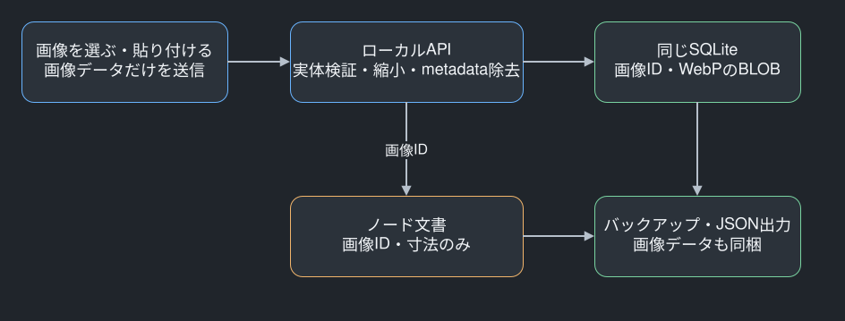

# ノード画像はアプリのSQLiteへ取り込んで保存する

画像は選択・貼り付け時にバイト列として取り込み、アプリが管理するSQLiteの画像テーブルへ保存する。ノードには画像IDだけを持たせ、元ファイルのパス、ファイル名、外部URLは保存しない。元画像を移動・削除しても、取り込み済みの画像は表示できる。SQLiteのバックアップには文書と画像の両方が含まれる。

## 画像実体と文書を同じDBに置く

画像の正式な保存先は、既存のマップ文書と同じ永続DBである。Docker Composeではホストのデータディレクトリをコンテナの `/app/data` へマウントし、`/app/data/mindmaps.sqlite` の `image_assets` テーブルへBLOBとして保存する。アプリ再起動やコンテナの再作成で失う一時領域には置かない。画像を静的公開ディレクトリへ置くことも、利用者の画像フォルダーを参照し続けることもしない。

`image_assets` は、画像ID、所有マップID、保存形式、幅・高さ、バイト数、SHA256、画像本体、作成日時を保持する。画像IDはUUIDで、所有マップIDには外部キーを設ける。同一マップ内の同一ハッシュは再利用する。バイナリをマップのJSONやUndo履歴へ毎回複製しないため、本文の自動保存が画像の大きさに比例して重くなりにくい。

文書の `imageAssets` は画像IDから形式・寸法・バイト数を引く辞書で、バイナリを含まない。各ノードの `images` は画像IDの順序付き配列で、1ノード8枚までを表示できる。保存APIは文書内の画像情報がDBの同じマップの画像と一致することを確認する。存在しないIDや、別マップのIDを差し替えても保存・表示できない。

## 選んだデータを検証・正規化してから保存する

PNG・JPEG・WebPの静止画を受け付ける。HTTPの種類だけを信用せず、デコーダへ渡す前に形式の署名を確認し、デコード後にも実体の形式・寸法を照合する。SVG、アニメーション、破損画像は拒否する。PNGのアニメーション制御チャンクもデコード前に検査し、APNGの2枚目以降を黙って捨てない。SVGをPNGと偽装しても、SVGのデコーダへ渡さない。元パスや外部画像URLを受け取るAPIは提供しない。

入力は1枚10MiB、2500万画素までとする。向きを補正し、長辺2048px以下へ縮小したうえで、EXIF・位置情報・ICC・XMPなどを保持しないロスレスWebPへ変換する。保存後は1枚8MiBまでとし、超過時は画像を小さくして再試行するよう案内する。スクリーンショットの文字を不必要な非可逆圧縮で崩さず、写真など過大な入力は制限する初期値である。原本そのものの保存や、原本への復元は保証しない。

元パスを使わない制約は、画像に写っている文字や人物を自動匿名化するという意味ではない。画像内容自体は利用者のデータとしてローカルDBに残る。画像DBとバックアップはGit・Docker build contextから除外し、テストや公開資料には合成画像だけを使う。

## 表示とバックアップは同一オリジンのAPIを使う

| 操作 | API | 入力・出力 |
| --- | --- | --- |
| 画像を取り込む | `POST /api/maps/:mapId/images` | raw画像 → IDと寸法情報 |
| 保存画像の情報を読む | `GET /api/maps/:mapId/images` | IDと寸法情報の配列 |
| 画像を表示する | `GET /api/maps/:mapId/images/:imageId` | WebPのバイト列 |
| 画像付きJSONを出す | `GET /api/maps/:mapId/backup` | 文書と画像を含むbundle |
| JSONを新規マップへ読む | `POST /api/maps/import` | bundle → 新しい文書 |

更新リクエストは従来と同じHost・Origin照合を行う。画像表示はマップIDと画像IDの両方で所有を照合し、レスポンスを `image/webp`、`nosniff`、`no-store` とする。保存された元ファイル名をレスポンスへ露出することはなく、ファイルシステムのパスを組み立てる処理も必要ない。

## Undo・復旧候補・ゴミ箱から画像を失わない

ノードから画像を外しても、画像本体を即座に削除しない。Undoで参照を戻す場合と、過去5世代の復旧候補から戻す場合に同じ画像が必要になるためである。マップをゴミ箱へ移した間も保持し、30日以内の復元で画像を失わない。確認を経てマップを完全削除したときは、画像も外部キーの連鎖で削除する。

1マップの保持上限は200枚・合計64MiBで、現在ノードから外れている画像も含む。取消したアップロードもこの保持量へ計上する。上限に達した場合は、現在の内容を画像付きJSONへ書き出し、新規マップとして読み込むと現在使用中の画像だけを引き継げる。元マップを残す限り、過去の復旧候補は元マップ側へ残る。自動整理でUndoや復旧候補を壊すことはしない。

## JSON・SQLiteの両方で画像を持ち運ぶ

画像付き文書は `mindmap-document` のschemaVersion 2を使う。schemaVersion 1の既存文書とJSONは読み続けられ、画像を初めて添付した時点で2へ進む。通常の文書保存は画像のバイナリを含めず、従来の10MiB上限を維持する。

画像付きJSONは `mindmap-backup` のschemaVersion 1で、`document` と `assets` を持つ。画像はBase64で同梱し、ローカルファイルへの参照を出力しない。上限は100MiBで、現在のノードが使う画像だけを含める。最後の画像を外したschemaVersion 2の文書は、画像情報の省略と空の画像配列を許可して画像0枚でも往復できる。読込は画像と文書の完全性を検査してから、マップ・ノード・画像のIDを再生成し、一回のトランザクションで作成する。不正Base64、欠けた画像、不一致の寸法、過大ファイルでは元のマップも新規マップも途中状態にしない。

SQLiteのバックアップAPIは画像BLOBと文書を同じコピーに含める。起動時とバックアップの整合性検査では、現在文書と復旧候補の画像参照・寸法、画像BLOBの長さ・ハッシュを照合する。復元は従来どおりサーバーを停止し、現状DBを退避してから行う。画像ファイルを別にコピーする手順はない。

## 検証した範囲と依存

保存APIの試験では、取り込み・同一画像再利用・他マップの参照拒否・画像除去後の参照復活・復旧候補・ゴミ箱・完全削除を確認した。破損、SVGとPNG偽装SVG、アニメーション、巨大寸法、本文上限、パス指定、他Originを拒否した。EXIF除去、2048pxへの縮小、200枚の保持上限、BLOB破損検知も合成画像で検証した。画像付きJSONの新規読込と、SQLiteバックアップの実リストアで画像本体を比較した。通常PNGの付随テキストをAPNGと誤認しないこと、最後の画像を外した文書のJSON往復も確認した。独立Compose環境で画像の保存、再起動、バックアップ、実リストア後の文書・画像bytes一致を確認した。runtimeイメージには保存層が利用するIOと配置のモジュールも含め、CIはホストデータを渡さないネットワークなしコンテナの起動を検査する。ブラウザの添付・描画・コピー・出力はUI側の受入試験で別途確認する。

画像処理にはsharp 0.35.5を固定して使う。sharpはLovell Fullerを中心とするOSSでApache-2.0、内部のlibvipsはLGPL-2.1である。実行時に画像を外部サービスへ送信しない。導入時のnpm auditは脆弱性0件だったが、新しい脆弱性がない保証ではない。更新時は依存監査と偽装・過大画像の拒否を再確認する。

[sharp公式リポジトリ](https://github.com/lovell/sharp)、[入力制限](https://sharp.pixelplumbing.com/api-constructor/)、[出力とメタデータ](https://sharp.pixelplumbing.com/api-output/)、[インストール条件](https://sharp.pixelplumbing.com/install/)、[libvipsのライセンス](https://github.com/libvips/libvips/blob/master/LICENSE)を確認した。
