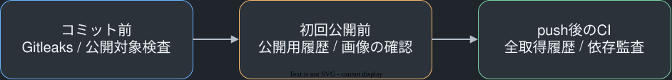

# 公開前とコミット時の情報保護



公開するのはソースコードと合成データによる試験記録に限る。SQLite、バックアップ、認証設定、秘密鍵、個人のホームディレクトリを含む記述は公開対象にしない。Gitleaksによる秘密値の検出と、公開対象ファイルの検査をコミット前に行い、CIでも再実行する。アプリのDBや編集内容をCIへ送る構成はない。

## コミット前に秘密値と公開対象を検査する

pre-commit 4.7.0がGit hookを管理し、Gitleaks 8.30.1のstaged検査と、公開対象チェックを実行する。検査に失敗するとコミットは成立しない。Gitleaksは検出した値を伏せて出力する。独自チェックはファイル名と失敗した分類だけを表示し、値を出力しない。

公開対象チェックはGitの候補・index・指定したrevisionのblobだけを読む。無視したローカルの秘密情報やDBを読む目的でリポジトリ全体を走査しない。DB、バックアップ、環境変数ファイル、秘密鍵、認証ディレクトリはGitとDocker build contextから除外する。強制追加された場合も公開対象チェックで拒否する。5MiBを超える単一ファイルは、実データや巨大な出力を誤送信しないため個別確認の対象として拒否する。

開発環境ではGitleaksとpre-commitを導入してから、このリポジトリのhookを設置する。次の /path/to/web-mindmap は配置先の絶対パスへ置き換える。

```sh
brew install gitleaks
uv tool install pre-commit==4.7.0
cd /path/to/web-mindmap
pre-commit install
npm run security:files
npm run security:staged
npm run security:history
npm run security:audit
```

pre-commitの版は /path/to/web-mindmap/requirements-security.txt に固定する。hookはcloneしただけでは有効にならず、各開発環境での設置が必要である。Gitleaksが利用できない環境はhookを成功扱いにしない。

## 公開履歴と画像は別に確認する

現在のファイルから秘密情報を取り除くだけでは、過去のcommitにあった情報は消えない。初回公開では公開用の履歴だけを対象にし、非公開のローカル履歴や別branchを一緒に送信しない。公開対象のtreeに対する検査は次の操作で行う。

```sh
cd /path/to/web-mindmap
node /path/to/web-mindmap/scripts/check-publication.mjs --ref HEAD
```

Gitleaksはすべての個人情報や画像の文字を検出するものではない。公開する画像は合成マップの画面に限り、目視でも確認する。ローカルの探索評価資料は公開対象から除外する。画像内の実マップや認証画面、検査対象外に置いたファイルを、手動で公開しないようにする必要がある。

## CIは読み取り権限で履歴と依存を検査する

CIはpushとpull requestで起動し、checkoutした全取得履歴をGitleaksで検査する。公開対象チェック、本番ビルド、自動試験、npm auditも実行する。Actionsの権限はcontents: readに限定し、checkout後の認証情報を保存しない。デプロイやDB操作のworkflowは含まない。

公式Actionsは確認した完全なcommit SHAへ固定する。GitleaksのLinuxバイナリは公式v8.30.1配布物を使い、記録したSHA256との一致を確認してから実行する。依存の取得はlockfileを使い、npm ci --ignore-scriptsで不要なインストールスクリプトを実行しない。npm auditはhigh以上の検出で失敗する。

## 隔離した合成リポジトリで拒否動作を確認した

2026年11月8日、通常の合成ファイルはhook付きのcommitに成功した。Gitで無視したDBと環境変数ファイルは公開対象検査から除外され、DBを強制追加するとcommitを拒否した。合成のホームディレクトリ表記も拒否した。実際には認証できないGitHubトークン形式の文字列を生成して追加するとGitleaksがcommitを拒否し、その値が出力されないことを確認した。実データや実際の資格情報を試験に使っていない。

入れ子のディレクトリを含む10種類の合成ファイルでも、Docker build contextを実際に書き出して検査した。修正前は環境変数ファイル、認証設定、backup/backups配下、SQLite3のWAL/SHM、DB journalを含む10件が送られた。除外を全階層へ揃えた後は10件とも送られず、安全なソースは残った。同じ10件がGitで無視され、強制追加した場合は公開対象チェックで全件を拒否することも確認した。実DBや実際の資格情報はcontextへ入れていない。

同日のnpm auditは脆弱性0件だった。これはその時点の監査結果であり、新しい脆弱性や未登録の問題がない保証ではない。ローカルhookは開発環境側で無効化され得るため、公開前の検査とCIを併用する。それでも任意の秘密値、画像、仕様書の内容すべてについて漏えいが絶対に起こらないと保証する仕組みではない。

## 根拠となる公式資料

[Gitleaksの利用方法](https://github.com/gitleaks/gitleaks)、[pre-commitの導入とhook](https://pre-commit.com/)、[GitHub Actionsの安全な利用](https://docs.github.com/en/actions/reference/security/secure-use)、[Gitleaks v8.30.1の配布物](https://github.com/gitleaks/gitleaks/releases/tag/v8.30.1)を確認した。Gitleaksの公式方針は新機能追加を終え、セキュリティ修正を続ける状態である。更新時は版、配布物のchecksum、検出の拒否動作を再確認する。
