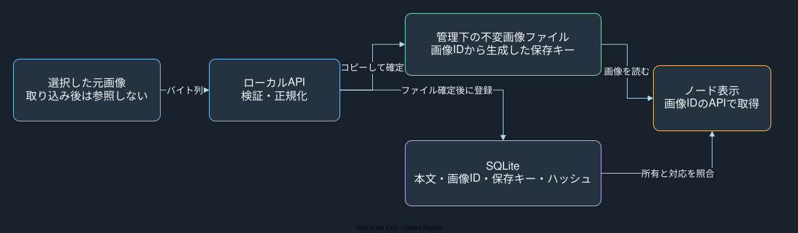
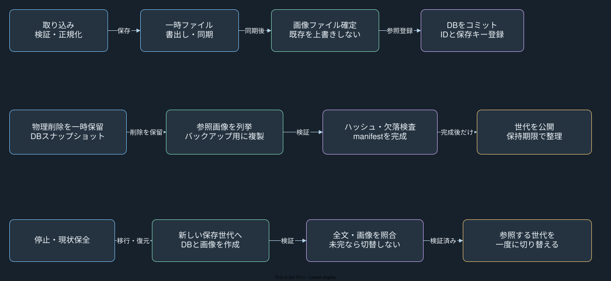

# 画像保存方式の再評価：画像を多用するなら管理下ファイルへ分離する

**提案・未実装。** 画像を継続して増やす使い方には、画像本体をアプリ管理下のファイルへ分離し、SQLiteには画像ID・管理用の保存キー・寸法・ハッシュを残す方式を推奨する。元画像の場所を参照する方式ではなく、取り込んだデータをアプリ自身が所有する。現在の実装は[SQLiteへ画像を格納する方式](node-images.md)のままであり、この資料によるコード変更、既存画像の移行、保存先の切替は行っていない。

SQLiteのBLOB保存が直ちに危険という結論ではない。画像が少量なら、本文・画像・復旧候補を同じDBで扱い、SQLiteのバックアップAPIだけで一体保全できる利点が大きい。ファイル分離を推奨する理由は、画像が増えた際のDB全体コピーと検証の負担を分けて管理するためである。画像を外へ出すだけで、画像自体の総容量が減るわけではない。

## 現実装の懸念は、1枚の大きさより全体の成長にある

現実装は1枚10MiBの入力を検査し、長辺2048px・保存8MiB以内のWebPへ正規化する。1マップ200枚・合計64MiBの保持上限があり、本文JSONには画像本体を入れない。通常の本文保存や復旧候補の作成のたびに画像を丸ごと複製する実装ではない。一方、64MiBはマップごとの上限で、アプリ全体のマップ数と画像総量の上限ではない。[保存処理](../server/store.ts)と[画像の上限](../server/images.ts)で確認した。

日次の初回保存時にはDB全体を別ファイルへバックアップし、日次分を直近7世代保持する。手動バックアップは別に作成でき、自動削除対象に入らない。仮に100マップがそれぞれ64MiBの画像を保持すれば、画像だけで6.25GiBとなる。同じ量の画像が全世代へ入る場合、稼働DBと日次7コピーだけで約50GiBになる計算である。これは空きページ、本文、作業用領域、手動分を無視した容量例で、実測値ではない。

起動時とバックアップ検査は、全画像を`SELECT * ... .all()`で一度に読み、各BLOBの長さとハッシュを照合する。このため、画像総量に応じて読み込み量・検証時間・ピークメモリが増える。これは保存先の選択とは別の改善点であり、BLOB保存を維持しても、画像を逐次読む検証へ変えることで一括読込の負担は減らせる。現在のデータ量や実機での起動時間・メモリ量は測定していない。

## 公式の比較は、保存先を一律に決める閾値ではない

[SQLite公式の内部BLOBと外部ファイルの比較](https://www.sqlite.org/intern-v-extern-blob.html)では、小さいBLOBにDB内保存が有利な結果と、大きいBLOBに別ファイルが有利な結果が示される。ただし主要な測定は2011年のSQLite・Linux・SATAディスク環境であり、2017年の追記も特定の小サイズの比較である。そこで示される100KB付近の境界を、現在のMacやこのアプリの普遍的な切替基準にはしない。

現在の画像サイズの分布、合計量、起動時の検証、バックアップ所要時間を同じ条件で測って判断する。少量運用を優先するならBLOBのまま逐次検証と全体容量管理を改善する案も妥当である。画像を多用し、画像の差分バックアップも行う想定では、以下のファイル分離案を標準候補とする。

## 保存するのは元ファイルのパスではなく、生成した管理用キー

ブラウザは画像のバイト列だけを取り込みAPIへ渡す。APIは現在と同じ形式・寸法・容量の検査と正規化を行い、生成した画像IDから管理用の相対キーを決める。例は`images/v1/ab/<画像UUID>.webp`であり、元ファイル名・元の絶対パス・外部URLから作らない。DBにはこのキーと所有マップID、形式、寸法、バイト数、ハッシュを持たせ、画像本体のBLOBを持たせない。

保存先は、例えばアプリの`/app/data/stores/<保存世代ID>/assets/`配下へ固定する。ノードとブラウザのJSONは現在どおり画像IDで参照し、画像表示APIもマップIDと画像IDのまま維持する。物理的な保存キーをブラウザへ返す必要はない。元ファイルを移動・削除しても表示でき、ホストのユーザー名やDocker内外の配置にも依存しない。

APIから任意のパスを受け取らず、生成済みキーも決めた書式と照合する。絶対パス、親階層への移動、URL、許可形式以外の拡張子は拒否する。解決先が管理ルート内であることと、シンボリックリンクを介して外へ出ないことを確認する。管理ディレクトリはアプリだけが書ける権限とし、既存の画像ファイルを別内容で上書きしない。この制約は実装・対象OSでの検証が必要である。

## DBとファイルの間では、参照欠けを作らない順序を守る

取り込みは、同じファイルシステム上の一時ファイルへ書き、書込みを同期してから確定名へ公開し、その後DBへ対応情報をコミットする。保存処理の排他と既存ファイルを上書きしない公開方法を実装し、必要なディレクトリ同期も行う。SQLiteのトランザクションが、外部の画像ファイルまで原子的に扱うわけではない。

ファイル確定後・DBコミット前に停止すると、参照されない画像ファイルが残り得る。表示するDB参照だけが先に残る状態を避け、未完の一時ファイルと参照されない確定ファイルは後から整理する。整理は取り込み・バックアップ・復元と競合しない保守処理で行い、DBに登録される前の処理中ファイルを消さない。

ノードから画像を外しても実体は保持し、Undo・過去5世代の復旧候補・ゴミ箱の復元で使う。マップの完全削除はDB側で確定してから物理削除候補へ送り、進行中のバックアップや読出しが参照する間は削除しない。外部ファイルには外部キーの連鎖削除が効かないため、この整理処理を明示的に持つ。

起動時にはDB・参照先の存在・サイズを確認し、全画像ハッシュの検証は逐次処理として進捗とメモリ使用量を制御する。読出し時のハッシュ照合と、バックアップ・定期保守での完全検証を組み合わせる案とする。ファイル分離しても、全画像を一括読込する検証を残せば同じ問題は残る。

## バックアップはDB単独から、DBと画像の完成したセットへ変わる

[SQLiteのバックアップAPI](https://www.sqlite.org/backup.html)が保証するのはDBのスナップショットであり、別ファイルの画像は含まれない。したがって、現在のDBファイルだけのバックアップ・復元コマンドを、そのまま新方式へ流用しない。

バックアップ中は画像の物理削除を保留し、SQLiteのスナップショットから必要な画像を列挙する。対象は現ノードだけでなく、復旧候補とゴミ箱のために保持している画像を含む。その画像を複製し、画像ID・保存キー・サイズ・ハッシュを対応付けたmanifestと照合する。DB・manifest・全画像がそろった世代だけを完了扱いにし、欠けた途中世代を復元元に出さない。不変ファイルなので、取得後に中身が別画像へ変わる更新は許さない。

毎回全画像を別コピーするなら、ファイルへ分けてもバックアップ容量はほぼ減らない。容量削減を狙う場合は、バックアップ側にハッシュ単位の不変画像保管庫を設け、各日次世代は小さいDBとmanifestで必要な画像を参照する。日次7世代から一度も参照されなくなった画像だけを整理する。手動バックアップの保持方針と、外部ディスクへ複製する際に必要な画像を取り漏らさない梱包方法も決める必要がある。

復元では別の保存世代へDBと画像を展開し、参照・全画像ハッシュ・DB整合性を検査する。欠落や破損があれば現在の保存先を切り替えない。検査後、アプリが参照する保存世代IDを原子的に切り替える構成を提案する。保存世代IDも生成IDのみとし、任意のパスを設定する入口にしない。

## 既存BLOBの移行は、元を残した別世代で検証する

移行はアプリを停止し、現在のBLOB入りDBの検証済みバックアップを作ってから行う。空き容量には旧DB、展開する画像、新しいDB、検証・退避用領域が必要になる。画像のBLOBは再圧縮せず、そのバイト列を管理下ファイルへ書き出してハッシュを照合する。現在の画像IDを維持すれば、ノードと復旧候補の参照を書き換える必要はない。

新しいDBは別ファイルへ作成し、本文・復旧候補・ゴミ箱と画像の対応をコピーする。すべての画像と参照を検査した後に、新しい保存世代へ切り替える。旧BLOBの行だけを消してもDBファイルが直ちに小さくなるとは限らず、[SQLiteのVACUUM](https://www.sqlite.org/lang_vacuum.html)などによる再構築にも一時領域と時間が要る。この提案では新DBを別に作り、旧DBをそのまま退避する。

移行直後で新規の書込みがなければ、停止して旧世代へ戻せる。切替後に利用者が編集した場合は、旧DBへ単純に戻すと新しい編集を失うため、その方法を自動ロールバックにしない。最新データを保全して修復または逆変換する。旧DBと退避分の削除は、復元試験と利用確認を終えてから判断する。

画像付きJSONの持ち運び形式は維持し、書出し時に管理下ファイルからバイト列を同梱する。JSONへホストのパスや保存キーを持ち出さない。旧BLOB形式のバックアップも、別世代への展開・検査を経て復元できる互換経路が必要である。

## 実装前に確かめる範囲

この提案では実データの容量調査、合成画像によるBLOB対ファイルの比較計測、移行・復元の実行をしていない。アプリ全体の容量上限、空き容量を残す基準、手動バックアップの保持方針、移行に使う保守時間は未決である。

採用時は、取り込みの各確定境界での異常終了、整理とバックアップの競合、パストラバーサル・シンボリックリンク、画像欠落・ハッシュ不一致、旧形式からの移行と復元を専用環境で確認する。少数画像と画像増加時の起動時間、ピークメモリ、バックアップ時間・保存量を同じ条件で比較し、方式変更の効果と追加した運用負担を評価する。
